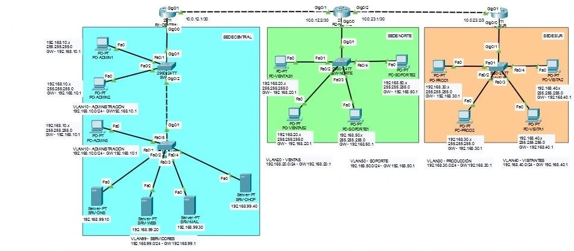

# Andes S.A. enterprise LAN

[Español](README.md) · [English](README.en.md)

**Nicolás Fontana · Nicolás Molo · Malena Silvestre** · Digital Techniques III · Electronic Engineering · UTN Facultad Regional Paraná · 2026.

The team connected three offices in Cisco Packet Tracer so each department had its own broadcast domain while sharing central network services. North acts as the transit site between Central and South.

The report documents OSPF adjacencies, inter-site connectivity, DHCP leases and application tests. It also examines service interruptions and restoration. The evidence comes from simulation.

- [Topology, IPv4 and VLANs (Spanish)](docs/topologia.md)
- [Routing and services (Spanish)](docs/servicios.md)
- [Verification and recovery (Spanish)](docs/verificacion.md)

Source: *Evaluación integradora – Red Empresarial Andes S.A.*, pp. 3–42. The topology on p. 5 was edited to remove access details. The original Packet Tracer file was unavailable.
