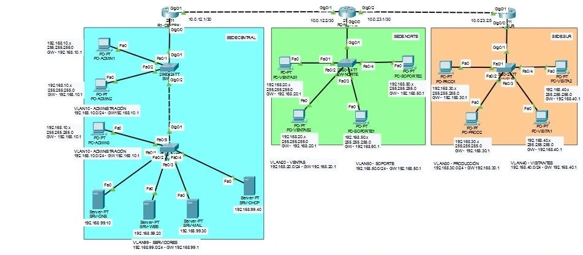

# Red empresarial multisede de Andes S.A.

[Español](README.md) · [English](README.en.md)

**Nicolás Fontana · Nicolás Molo · Malena Silvestre** · Técnicas Digitales III · Ingeniería Electrónica · UTN Facultad Regional Paraná · 2026.

Una oficina central aloja los servicios que necesitan los usuarios de tres sedes. El desafío fue separar los dominios de difusión por sector y permitir que los clientes remotos obtuvieran su configuración de red y accedieran a los servicios corporativos. El equipo diseñó y probó el escenario en Cisco Packet Tracer.

El informe documenta adyacencias OSPF, comunicación entre sedes, asignación DHCP y pruebas de servicios. La topología lineal concentra el tránsito entre Central y Sur en Norte. Las conclusiones corresponden al simulador.

- [Topología, direccionamiento y VLAN](docs/topologia.md)
- [Enrutamiento y servicios](docs/servicios.md)
- [Pruebas y recuperación](docs/verificacion.md)

Fuente: *Evaluación integradora – Red Empresarial Andes S.A.*, pp. 3–42. La figura procede de la p. 5 y se retiró la anotación de acceso. El archivo editable de Packet Tracer no acompañó al informe.
